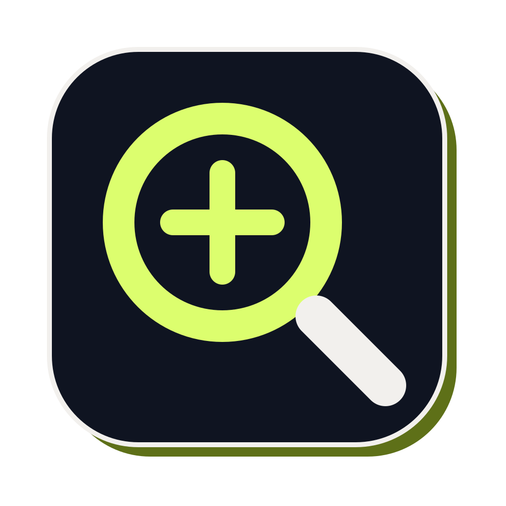
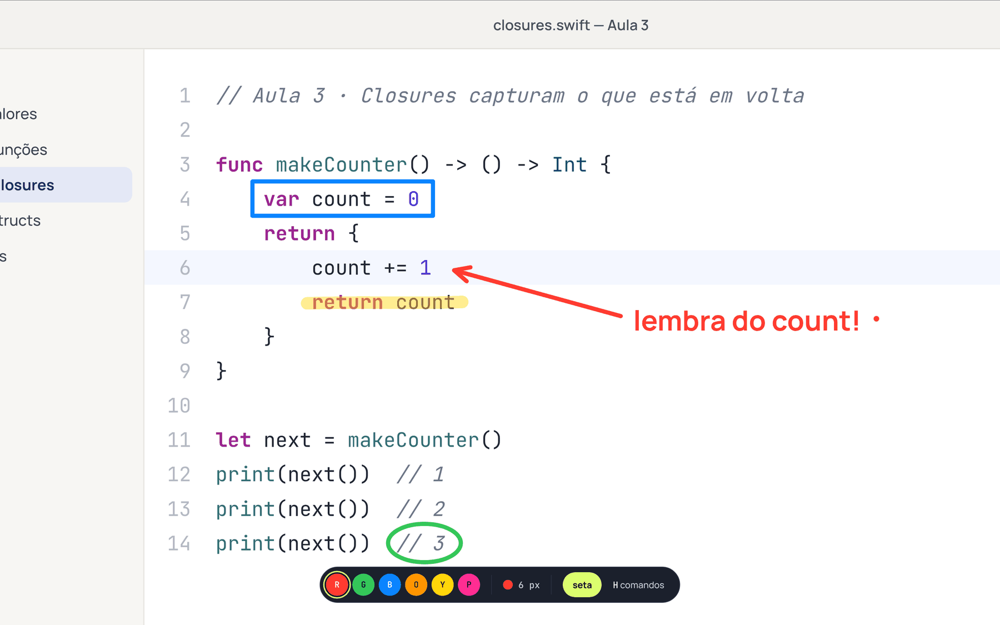
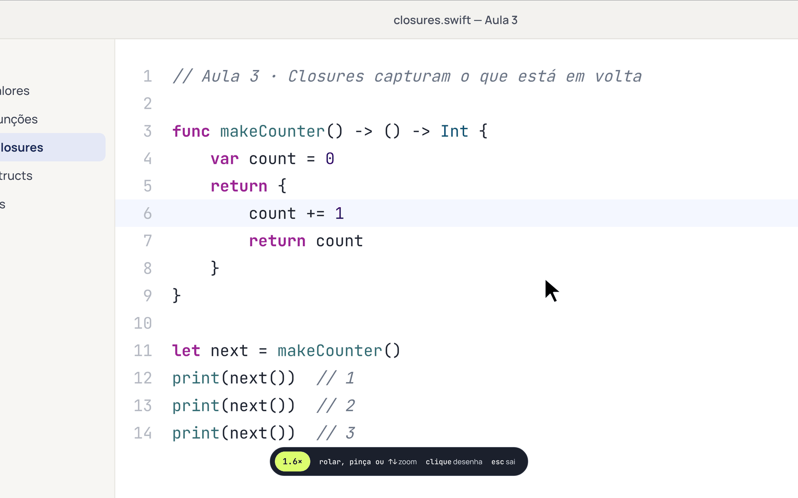
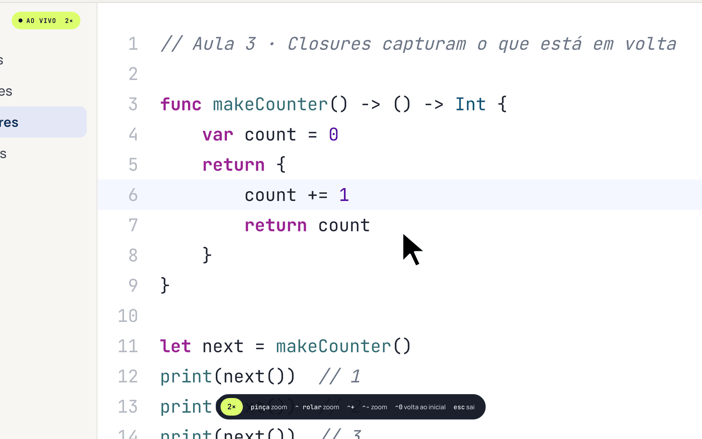
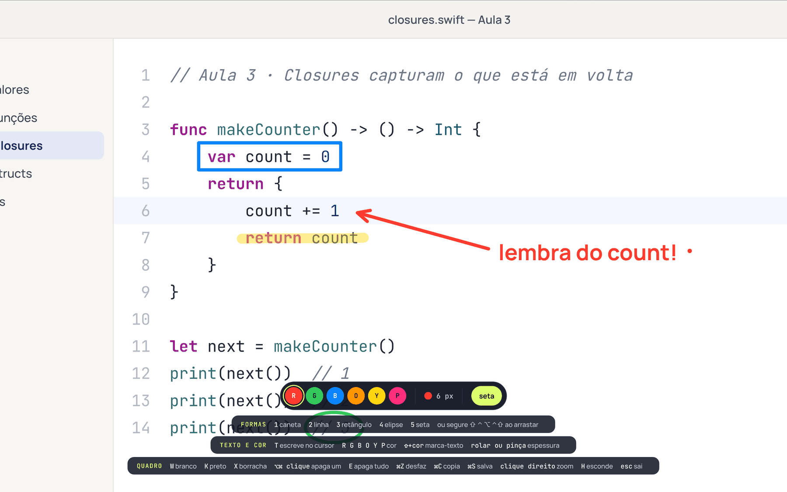
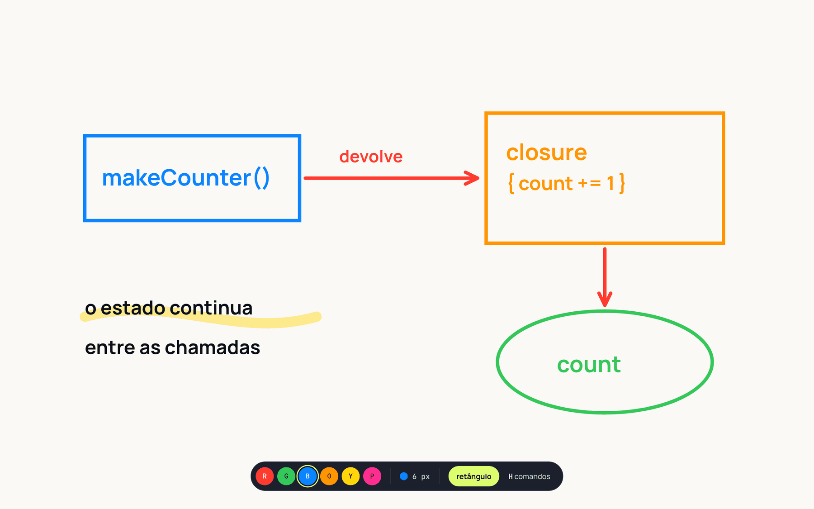
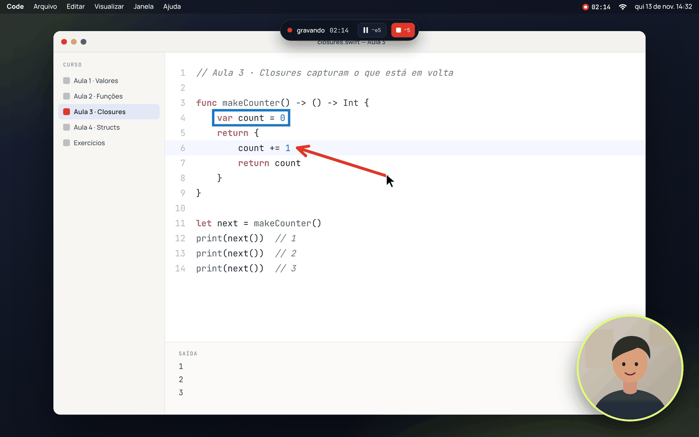
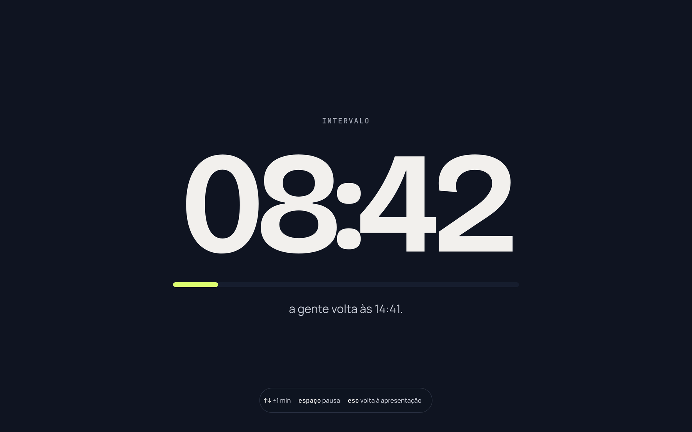
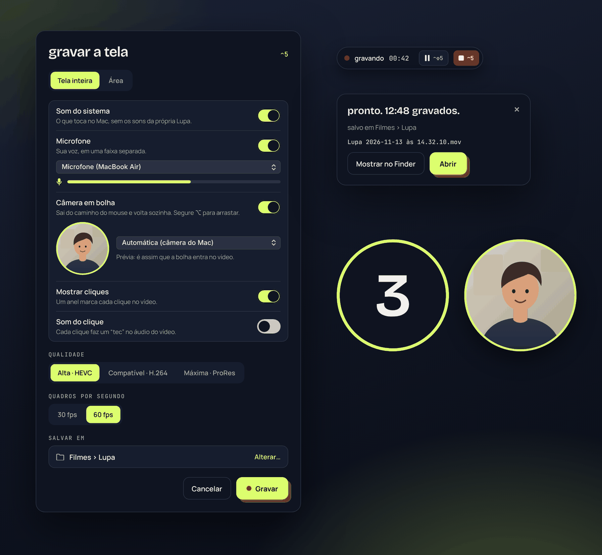

<p align="center">
  
</p>

<h1 align="center">Lupa</h1>

<p align="center">
  <strong>Zoom, desenho e gravação de tela para quem dá aula ou apresenta no Mac.</strong>
</p>

<p align="center">
  <a href="LICENSE"></a>
  
  
  
</p>

<p align="center">
  <a href="#instalação">Instalação</a> ·
  <a href="#primeiros-passos">Primeiros passos</a> ·
  <a href="#uso">Atalhos</a> ·
  <a href="#segurança-e-privacidade">Privacidade</a> ·
  <a href="README.md">Read in English</a>
</p>

<p align="center">
  
</p>

A Lupa fica na barra de menus e só aparece quando você aperta um atalho. Ela aproxima qualquer
ponto da tela, deixa você desenhar e escrever por cima, mostra um cronômetro de intervalo para a
turma e grava tudo em alta qualidade, com voz, som do sistema e câmera. A ideia vem do
[ZoomIt](https://learn.microsoft.com/sysinternals/downloads/zoomit), refeito de forma nativa para o
macOS.

É um app nativo em Swift, sem dependências, sem acesso à rede e sem telemetria. A interface
aparece em português quando o macOS está em português, e em inglês nos demais idiomas.

## Recursos

<table>
  <tr>
    <td width="50%" valign="top">
      
      <h3>Zoom <code>⌃1</code></h3>
      Congela a tela e aproxima em torno do cursor. Role ou faça a pinça para chegar mais perto,
      mova o mouse para navegar e clique para desenhar ali mesmo.
    </td>
    <td width="50%" valign="top">
      
      <h3>Zoom ao vivo <code>⌃4</code></h3>
      O zoom segue o cursor enquanto você trabalha, e os cliques chegam ao app embaixo. De 1× a 8×.
    </td>
  </tr>
  <tr>
    <td width="50%" valign="top">
      
      <h3>Desenho <code>⌃2</code></h3>
      Caneta, marca-texto, linhas, setas, retângulos, elipses e texto em seis cores. Aperte
      <code>H</code> e todos os comandos do desenho aparecem na tela.
    </td>
    <td width="50%" valign="top">
      
      <h3>Quadro <code>W</code> <code>K</code></h3>
      Troca a tela por um quadro branco ou preto para explicar do zero. No fim, copie ou salve
      como PNG.
    </td>
  </tr>
  <tr>
    <td width="50%" valign="top">
      
      <h3>Gravação <code>⌃5</code></h3>
      Resolução Retina até 60 fps, com zoom no clique, desenho sobre a tela em movimento e câmera
      em bolha que desvia do mouse.
    </td>
    <td width="50%" valign="top">
      
      <h3>Intervalo <code>⌃3</code></h3>
      Cronômetro em tela cheia, legível do fundo da sala, com o horário em que a aula volta.
    </td>
  </tr>
</table>

<p align="center">
  
  <br>
  <sub>O painel de gravação: origem, som do sistema, microfone com medidor de nível, câmera em bolha
  com prévia, anel e som nos cliques, qualidade, quadros por segundo e pasta.</sub>
</p>

## Requisitos

- macOS 15 Sequoia ou mais novo, em Mac com Apple silicon ou Intel
- Swift 6.0 ou mais novo: Xcode 16+, ou só as Command Line Tools (`xcode-select --install`)
- Git

## Instalação

A Lupa é compilada a partir do código. Não há binário notarizado.

```bash
git clone https://github.com/pauloFroes/lupa.git
cd lupa
scripts/build-app.sh --install --open
```

Uma lupa aparece na barra de menus. Pressione `⌃1`, permita **Gravação de Tela e Áudio do
Sistema** quando o macOS pedir e abra a Lupa de novo.

O `build-app.sh` compila em modo release, monta `build/Lupa.app` com ícone, fontes e traduções e
assina o app com um certificado local (veja [Permissões](#permissões)). As opções:

| Opção | Efeito |
| --- | --- |
| `--install` | Fecha a cópia aberta e substitui `/Applications/Lupa.app`. |
| `--open` | Abre o app e confere que a cópia nova é a que está rodando. |
| `--universal` | Compila para Apple silicon e Intel (precisa do Xcode). |

Para atualizar, puxe as mudanças e rode o mesmo comando:

```bash
git pull && scripts/build-app.sh --install --open
```

Para abrir junto com o Mac, ligue **Abrir ao iniciar sessão** no menu. Para desinstalar, feche a
Lupa e apague `/Applications/Lupa.app`; `tccutil reset All io.github.paulofroes.lupa` remove as
permissões.

## Primeiros passos

Um tour de cinco minutos pelo que a Lupa faz. Todos os atalhos estão em [Uso](#uso).

1. **Aproximar um detalhe.** Pressione `⌃1`. A tela congela e aproxima em torno do cursor; role ou
   faça a pinça para aproximar mais e mova o mouse para navegar. `Esc` sai.
2. **Apontar algo.** Pressione `⌃2` (ou clique durante o zoom) e arraste para desenhar. `R`, `G` ou
   `B` trocam a cor, `5` faz setas, `T` escreve, `W` abre o quadro branco, `E` apaga tudo. `H`
   mostra todos os comandos do desenho na tela. `Esc` sai.
3. **Aproximar enquanto trabalha.** Pressione `⌃4` para o zoom ao vivo: o zoom segue o cursor e
   os cliques chegam ao app embaixo. `⌃+` e `⌃-` mudam o zoom; `⌃4` ou `Esc` desligam.
4. **Gravar uma aula.** Pressione `⌃5` para abrir o painel de gravação:
   - escolha **Tela inteira** ou arraste uma **Área**;
   - ligue o **Microfone** e veja o medidor de nível se mexer quando você fala;
   - ligue a **Câmera em bolha** e escolha a câmera na prévia;
   - em **Salvar em**, clique em **Alterar…** para escolher a pasta (o padrão é `~/Filmes/Lupa`);
   - se quiser, ligue **Mostrar cliques** (anéis) e **Som do clique**.

   Clique em **Gravar**. Depois da contagem de 3 segundos, cada clique aproxima onde você clicou, e
   a imagem volta quando o mouse para; `fn`-clique clica sem zoom. `⌃2` desenha sobre a tela em
   movimento e `Esc` apaga, `⌥` + arrastar move a bolha da câmera e `⌃⇧5` pausa. `⌃5` de novo
   para; um painel oferece abrir o vídeo ou mostrá-lo no Finder.
5. **Dar um intervalo.** Pressione `⌃3` para um cronômetro em tela cheia; `↑` `↓` mudam um minuto.

Os ajustes da Lupa (`⌘,` com o menu aberto) mudam os atalhos, o zoom inicial, a cor da caneta, o
cursor do zoom ao vivo e a duração do intervalo.

## Uso

| Atalho | Modo | O que faz |
| --- | --- | --- |
| `⌃1` | Zoom | Congela a tela e aproxima em torno do cursor. Role, faça a pinça ou use `↑` `↓` para mudar o zoom; mova o mouse para navegar. Clique para desenhar ali mesmo. |
| `⌃2` | Desenhar | Desenha sobre a tela congelada, ou sobre o zoom se você veio do `⌃1`. Gravando ou no zoom ao vivo, desenha sobre a tela em movimento. |
| `⌃3` | Intervalo | Cronômetro em tela cheia. `↑` `↓` somam ou tiram um minuto, `espaço` pausa. |
| `⌃4` | Zoom ao vivo | Aproxima em torno do cursor enquanto você trabalha; o clique vai para o app embaixo. Pinça, `⌃` + rolar, `⌃+` e `⌃-` mudam o zoom entre 1× e 8×; `⌃0` volta ao inicial. |
| `⌃5` | Gravar | Abre o painel de gravação; gravando, para. `⌃⇧5` pausa e retoma. |

`Esc` sai de qualquer modo, exceto do zoom ao vivo durante a gravação, quando o `Esc` fica com os
apps. Todos os atalhos mudam em **Ajustes…** (`⌘,` com o menu aberto), junto com o zoom inicial, a
cor inicial da caneta, o cursor do zoom ao vivo e a duração do intervalo.

> `⌃1` a `⌃5` coincidem com "Ir para a Mesa 1…5" do Controle de Missão quando esses atalhos estão
> ligados em Ajustes do Sistema › Teclado › Atalhos de Teclado. Troque um ou outro.

### No desenho

| Tecla | Ação |
| --- | --- |
| `R` `G` `B` `O` `Y` `P` | Vermelho, verde, azul, laranja, amarelo, rosa. Com `⇧`, vira marca-texto. |
| `1`–`5` | Caneta, linha, retângulo, elipse, seta. A escolha vale até você trocar. |
| segurar `⇧` / `⌃` ou `⌘` / `⌥` / `⌃⇧` | Linha / retângulo / elipse / seta só no arraste atual. |
| `T` | Escreve no cursor (acentos funcionam); `Esc` termina o texto. |
| rolar ou pinça | Espessura do traço, ou tamanho da letra no texto. |
| `X` | Borracha que apaga itens inteiros; `⌥⌘`-clique apaga um item sem trocar de ferramenta. |
| `E` / `⌘Z` | Apaga tudo / desfaz, inclusive a borracha. |
| `W` / `K` | Quadro branco / preto. |
| `⌘C` / `⌘S` | Copia a imagem / salva um PNG na Mesa. |
| `H` | Mostra ou esconde os comandos. |
| clique direito | Volta ao zoom (se você veio do `⌃1`) ou sai. |

### Na gravação

O painel do `⌃5` escolhe tela inteira ou uma área, som do sistema, microfone (em faixa própria,
com medidor de nível), câmera em bolha, anel nos cliques, som de clique opcional, qualidade, taxa
de quadros e pasta de destino. Depois de uma contagem de 3 segundos, a Lupa grava na resolução
nativa da tela, e o ícone da barra de menus vira um ponto vermelho com o tempo corrido.

- **Zoom no clique.** A gravação roda dentro do zoom ao vivo: o clique aproxima até o zoom inicial
  e a imagem volta a 1× depois de 2,5 s com o mouse parado. `fn`-clique clica sem dar zoom.
- **Desenho na gravação.** `⌃2` desenha sobre a tela em movimento, sem congelar; `Esc` apaga o
  desenho e devolve o mouse aos apps.
- **Câmera em bolha.** Sai do caminho quando o cursor vai até ela e volta depois. Segure `⌥` para
  arrastar; o lugar fica salvo.
- **Arquivos.** `.mov` em `~/Filmes/Lupa` por padrão, com taxa de quadros constante. O microfone
  é a primeira faixa de áudio, então players que tocam uma faixa só tocam a sua voz.
- **Qualidade.** Alta (HEVC), Compatível (H.264) ou Máxima (ProRes 422, arquivos grandes, para
  editar).

Não há editor de linha do tempo; para cortar o começo e o fim, abra o arquivo no QuickTime Player
(`⌘T`).

## Permissões

| Permissão | Para quê |
| --- | --- |
| Gravação de Tela e Áudio do Sistema | Obrigatória. Zoom e desenho trabalham sobre uma foto da tela tirada na hora do atalho; a gravação filma a tela. |
| Microfone, Câmera | Só quando ligados no painel de gravação. |
| Acessibilidade | Opcional. Faz o zoom ao vivo ficar com a pinça e o `⌃` + rolar, sem que o app embaixo aproxime junto, e deixa o zoom no clique mais confiável. |

Depois de permitir a Gravação de Tela, abra a Lupa de novo.

O macOS amarra essas permissões à assinatura do app. Para elas sobreviverem às recompilações, o
`build-app.sh` cria na primeira vez um certificado autoassinado, **Lupa Local Signing**, no seu
chaveiro de início de sessão (`scripts/make-signing-cert.sh`) e assina sempre com ele. Quando a
assinatura muda, o `--install` zera as permissões antigas e pede para você permitir a Lupa de
novo. Se a Lupa aparecer permitida e ainda assim pedir, remova-a da lista com `−` e abra de novo,
ou rode:

```bash
tccutil reset ScreenCapture io.github.paulofroes.lupa
```

Para assinar com um certificado da Apple, exporte `LUPA_SIGN_IDENTITY="Apple Development: …"`
antes do script; `LUPA_SIGN_IDENTITY=-` assina ad hoc.

## Segurança e privacidade

A Lupa pede permissões amplas, então aqui está exatamente o que ela faz com elas. Tudo abaixo pode
ser conferido no código.

- **Sem acesso à rede.** A Lupa não faz nenhuma requisição de rede: sem telemetria, sem análise de
  uso, sem checagem de atualização. Nada do que você captura ou grava sai do seu Mac.
- **Sem código de terceiros.** O pacote não tem dependências; a Lupa usa só frameworks da Apple.
- **A tela fica no seu Mac.** As fotos da tela usadas no zoom e no desenho ficam na memória.
  Arquivos só são gravados quando você pede: imagens salvas vão para a Mesa, gravações para
  `~/Movies/Lupa` ou para a pasta que você escolher. O único arquivo que a Lupa apaga é o vídeo
  incompleto de uma gravação que falhou.
- **Sem monitorar o teclado.** Os atalhos são registrados pela API de atalhos do sistema, então a
  Lupa só recebe os atalhos que você definiu. Ela nunca vê as outras teclas.
- **Cliques do mouse só são observados.** O zoom no clique, o som do clique e o cursor do zoom ao
  vivo acompanham os botões do mouse por escutas só de leitura, que não conseguem bloquear nem
  alterar eventos, e nunca guardam onde você clicou. O zoom ao vivo é o único recurso que consome
  entrada, e só a pinça e o `⌃` + rolar, enquanto está ligado. As escutas são removidas quando o
  recurso para.
- **Logs sem conteúdo.** A Lupa registra estado interno (nível de zoom, registro de atalhos, erros)
  no log unificado do sistema. Nunca registra teclas, texto ou conteúdo da tela.
- **Dispositivos só quando você liga.** Microfone e câmera só são pedidos quando ligados no painel
  de gravação. Abrir ao iniciar a sessão vem desligado e usa a API de itens de login do sistema.

- **Certificado autoassinado.** O `build-app.sh` cria no chaveiro um certificado que serve só para
  assinar código (veja [Permissões](#permissões)). Ele não é confiável como raiz nem para TLS, e
  só o `codesign` pode usar a chave. Você pode apagá-lo no Acesso às Chaves quando quiser.
- **Sem notarização.** A Lupa não é notarizada pela Apple. Compilar a partir do código, como em
  [Instalação](#instalação), permite revisar exatamente o que roda.

Para remover tudo, feche a Lupa, apague `/Applications/Lupa.app` e rode
`tccutil reset All io.github.paulofroes.lupa`.

Achou uma vulnerabilidade? Reporte de forma privada, como descrito no [SECURITY.md](SECURITY.md).

## Desenvolvimento

Veja a seção [Development](README.md#development) do README em inglês, a
[visão geral da arquitetura](docs/ARCHITECTURE.md) e o [CONTRIBUTING.md](CONTRIBUTING.md). Issues
e pull requests podem ser escritos em português ou inglês.

## Licença

Código sob a [licença MIT](LICENSE). As fontes Bricolage Grotesque, Manrope e JetBrains Mono são
distribuídas sob a SIL Open Font License; veja `Resources/Fonts/`.
